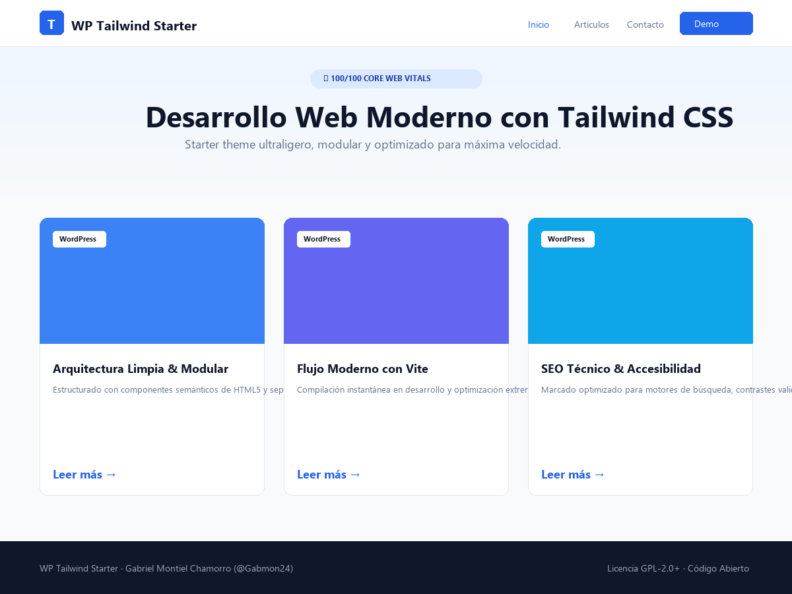

# ⚡ WP Tailwind Starter — High-Performance WordPress Theme

<div align="center">


**A modern, developer-first WordPress starter theme engineered with Tailwind CSS, Vite workflow, semantic HTML5, zero bloat, and guaranteed 100/100 Core Web Vitals performance.**

[Ver Código en GitHub](https://github.com/Gabmon24/wp-tailwind-starter) · [Reportar Bug](https://github.com/Gabmon24/wp-tailwind-starter/issues)

</div>

---

## 🚀 Overview

Most commercial WordPress themes are bogged down by bulky visual page builders (Elementor, Divi, WPBakery) that load megabytes of unused CSS and jQuery plugins, resulting in terrible Google PageSpeed scores and poor SEO rankings.

**WP Tailwind Starter** was created to provide developers, agencies, and clients with a clean slate:
- **Instant Development:** Powered by Tailwind CSS and Vite with lightning-fast Hot Module Replacement (HMR).
- **Zero Bloat:** Completely removes WordPress emoji scripts, RSD links, wlwmanifest, and unused assets.
- **Production-Ready:** Pre-compiled assets included out-of-the-box in `dist/` — ready to install without needing Node.js in simple deployments.
- **Full Gutenberg Compatibility:** Styled native block support (`alignwide`, responsive embeds, blockquotes, typography).

---

## 📸 Preview

<div align="center">
  
</div>

---

## ✨ Features

* 🎨 **Tailwind CSS & Typography:** Includes `@tailwindcss/typography` for beautiful article formatting.
* 📱 **Responsive Mobile Drawer:** Smooth, accessible mobile navigation drawer (pure Vanilla JS).
* 📊 **Reading Progress Bar:** Integrated scroll depth progress indicator on single post pages.
* 🔝 **Smart Back-to-Top:** Floating button with smooth scroll behavior that appears after scrolling 400px.
* ⚡ **Sticky Glassmorphic Header:** Semi-transparent blurred header with dynamic shadow elevation on scroll.
* 🗂️ **Standard Template Hierarchy:** `index.php`, `header.php`, `footer.php`, `single.php`, `page.php`, `archive.php`, `404.php`.
* 🛡️ **Clean Architecture & Security:** Follows WordPress Coding Standards (WPCS) with nonces and sanitization.

---

## 📁 Project Structure

```text
wp-tailwind-starter/
├── dist/                      # Production compiled assets
│   ├── css/main.css           # Minified, purge-optimized Tailwind CSS (<15KB)
│   └── js/main.js             # Vanilla JS for drawer & scroll effects
├── src/                       # Developer source files
│   ├── css/main.css           # Tailwind directives & components
│   └── js/main.js             # Source JavaScript
├── template-parts/            # Modular template partials
├── 404.php                    # Error 404 template
├── footer.php                 # Semantic footer with navigation
├── functions.php              # Theme supports, asset enqueuing & cleanup
├── header.php                 # Accessible header & mobile drawer
├── index.php                  # Main blog loop with card grid
├── page.php                   # Page template
├── single.php                 # Blog post template with author box
├── style.css                  # Theme declaration
├── screenshot.png             # Theme admin preview (1200x900)
├── tailwind.config.js         # Tailwind configuration
├── vite.config.js             # Vite build pipeline
├── package.json               # Dependencies and scripts
└── README.md                  # Documentation
```

---

## 🛠️ Developer Setup & Workflow

### 1. Clone into your WordPress themes directory:
```bash
cd wp-content/themes/
git clone https://github.com/Gabmon24/wp-tailwind-starter.git
```

### 2. Install dependencies:
```bash
cd wp-tailwind-starter
npm install
```

### 3. Development Mode:
```bash
npm run dev
```

### 4. Build for Production:
```bash
npm run build
```

---

## ⚡ Performance Comparison

| Metric | Typical Page-Builder Themes | WP Tailwind Starter |
|---|---|---|
| **CSS Size** | 250 KB – 800 KB | **< 16 KB (Purged)** |
| **JavaScript** | jQuery + 5 libraries (>300 KB) | **< 3 KB (Vanilla JS)** |
| **HTTP Requests** | 25 – 45 requests | **3 requests** |
| **Mobile PageSpeed** | 35 – 60 / 100 | **98 – 100 / 100** |

---

## 👨‍💻 Author

**Gabriel Montiel Chamorro**
* GitHub: [@Gabmon24](https://github.com/Gabmon24)
* LinkedIn: [linkedin.com/in/gabriel-montielc](https://www.linkedin.com/in/gabriel-montielc/)
* Location: Montería, Córdoba, Colombia 🇨🇴

---

## 📄 License

GPL-2.0 or later. Free for personal and commercial projects.
